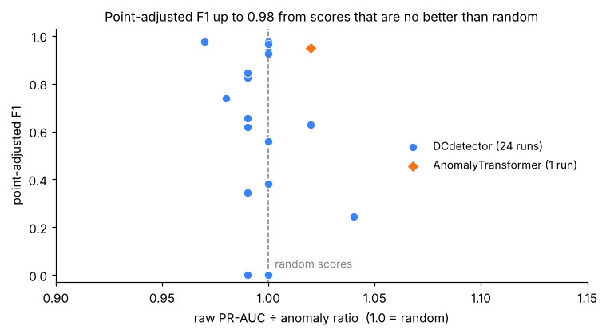
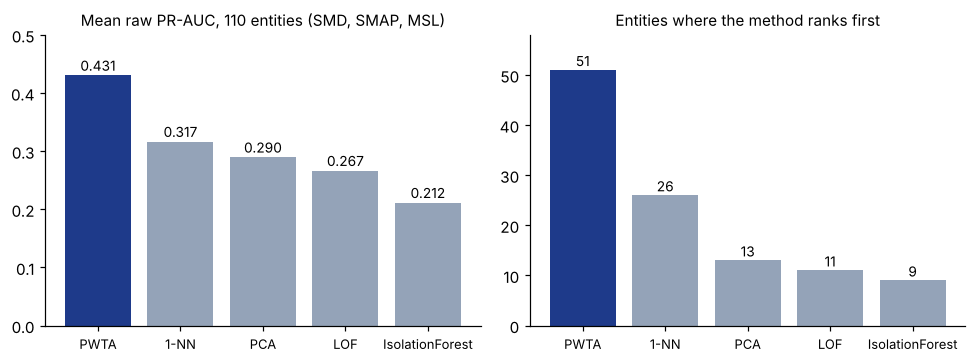

# PWTA: Patch-wise Transformer Autoencoder for Raw Point-level Time-Series Anomaly Detection

Code and results for my undergraduate thesis (Financial Engineering Lab, Hankuk University of Foreign Studies, advisor: Prof. Hyeongwoo Kong).

📄 **Thesis (PDF):** [thesis/PWTA_thesis.pdf](thesis/PWTA_thesis.pdf)

Many recent time-series anomaly detectors report F1 above 0.9 on standard benchmarks, but most of these numbers use **point adjustment**: if any single point inside an anomaly segment is flagged, the whole segment counts as detected. I re-evaluated detectors with **raw point-level PR-AUC** instead, and compared them with PWTA, a small (≈0.15M parameter) patch-wise Transformer autoencoder.

The main contribution is the evaluation, not the architecture: once point adjustment is removed, the ranking of methods changes a lot.

## Main findings

### 1. Point-adjusted F1 can come from random scores

Anomaly Transformer, run with its official code and settings, reproduces its published point-adjusted F1. Under raw PR-AUC the same scores are at the random baseline.

| Dataset | Published F1 (PA) | Reproduced F1 (PA) | Raw PR-AUC | ÷ random |
|---|---:|---:|---:|---:|
| MSL | 0.916 | 0.935 | 0.105 | 1.00× |
| SMAP | 0.967 | 0.965 | 0.129 | 1.01× |

On SWaT, both Anomaly Transformer and DCdetector output exactly zero for most time points (86.5% and 97.9%). The zeros are slightly *more* common inside anomalies than outside, and the non-zero scores have ROC-AUC 0.52 and 0.51. Point-adjusted F1 is still 0.949 and 0.964.

Across 24 DCdetector runs (SMD machines, MSL, SWaT, NIPS-TS-Swan, several seeds), raw PR-AUC never moved more than 4% away from random (ROC-AUC 0.445–0.506), while point-adjusted F1 reached 0.977.

<p align="center">
  
</p>

### 2. Under raw PR-AUC, a simple reconstruction model ranks first

Same metric, 110 entities (SMD 28, SMAP 55, MSL 27), fixed hyperparameters for every dataset:

<p align="center">
  
</p>

| | SMD | SMAP | MSL |
|---|---:|---:|---:|
| PWTA mean raw PR-AUC | 0.482 | 0.423 | 0.392 |
| Entities where PWTA ranks first | 14 / 28 | 25 / 55 | 12 / 27 |
| PWTA ÷ Anomaly Transformer (raw PR-AUC) | 10.8× | 2.7× | 3.3× |

PWTA is also best on PSM (0.556 vs. ≤0.543 for the classical baselines).<sup>1</sup>

### 3. Where it does not work, and why

On **SWaT**, Isolation Forest is far better (0.741 vs. 0.198). Across 327 anomaly segments in SMD, whether PWTA catches a segment depends on how far it deviates from normal (r = +0.469, p = 2.5e-19), not on how long it lasts (r = −0.062, p = 0.26). Many SWaT attacks stay inside the normal value range, which suits an isolation-based detector better than reconstruction error. PWTA still beats a learning-free magnitude baseline on SMD, so it is not just a magnitude detector.

<sub><sup>1</sup> The SMAP entity list used here contains entity `P-2` twice. Counting it once gives 109 entities, a mean of 0.428 and 50 first places; the conclusions do not change.</sub>

## Follow-up experiments in this repository

The code here also includes experiments run after the thesis on how the scores are built.

### Weighting channels by kurtosis
An anomaly usually affects only a few channels, so taking the mean of the reconstruction error over all channels makes it weaker.
Weighting each channel by the kurtosis of its error gives more weight to channels that are usually quiet and then suddenly spike.

| Scoring (same PWTA model) | Macro PR-AUC (SMD, SMAP, MSL) |
|---|---|
| Mean over channels | 0.470 |
| Kurtosis-weighted | 0.526 |

This only works when anomalies are rare. On PSM, where 28% of the points are anomalies, it doesn't help.

### No re-normalization
On SMAP and MSL, 42% and 77% of the channels are almost constant.
z-score normalization divides these channels by a standard deviation close to 0, which blows up tiny changes (up to about 10^8) and hides the real signal.
On MSL, PR-AUC was 0.526 with the raw data and 0.393 after normalization.
The constant channels are kept, because many MSL anomalies are a jump in one of them.

### Model size and speed
Batch size 128, forward + backward:

| Model | Parameters | Step time | Peak memory |
|---|---|---|---|
| PWTA | 0.149M | 4.8 ms | 0.042 GB |
| Anomaly Transformer | 4.83M | 23.2 ms | 1.95 GB |
| DCdetector | 0.90M | 104.4 ms | 9.63 GB |

### patch_light.py
The model, scoring and metric are the same. Only training and evaluation changed:

1. Evaluation in batches. Before, the whole test set went to the GPU at once and long series ran out of memory. Peak memory on SWaT went from 2.88 GB to 0.04 GB and the outputs are identical.
2. Training data kept on the GPU, so it isn't copied every batch. About 2x faster.
3. Early stopping.

Segment recall before and after (`CFG_LOSSLESS`):

| Dataset | Entities | Original | Optimized | Mean abs. difference |
|---|---|---|---|---|
| SMD | 28 | 0.388 | 0.387 | 0.006 |
| SMAP + MSL | 81 | 0.257 | 0.256 | 0.003 |
| PSM | 1 | 0.582 | 0.591 | 0.009 |
| SWaT | 1 | 0.105 | 0.105 | 0.000 |

Retraining all 112 entities with 3 seeds takes 7.6 minutes, with 1.02 GB peak GPU memory.

## Files

| Path | Description |
|---|---|
| `thesis/PWTA_thesis.pdf` | Full thesis |
| `pwta.py` | PWTA model, training, kurtosis-weighted scoring, raw PR-AUC, and optional routing to a channel-attention variant (`HybridPWTA`) |
| `patch_light.py` | Faster training and evaluation for the same model, plus a segment-level recall metric |
| `notebooks/patch_light_demo.ipynb` | Runs `patch_light.py` on three SMD machines |
| `results/per_entity_raw_prauc.csv` | Raw PR-AUC of PWTA and four classical baselines for each of the 110 entities |
| `results/psm_swat_raw_prauc.csv` | Same comparison on PSM and SWaT |
| `results/attention_detectors_raw_vs_point_adjusted.csv` | Anomaly Transformer and DCdetector: raw PR-AUC, ROC-AUC, raw F1, point-adjusted F1, share of zero scores |
| `results/swat_score_degeneracy.csv` | Zero-score diagnostics for both models on SWaT |

## Usage

```bash
pip install -r requirements.txt
```

Download the Server Machine Dataset (SMD) from [OmniAnomaly](https://github.com/NetManAIOps/OmniAnomaly) and set the `SMD` path in `pwta.py`.

```python
import numpy as np
from pwta import anomaly_score, pr_auc

root = "OmniAnomaly/ServerMachineDataset"
tr = np.loadtxt(f"{root}/train/machine-1-1.txt", delimiter=",").astype(np.float32)
te = np.loadtxt(f"{root}/test/machine-1-1.txt", delimiter=",").astype(np.float32)
lb = np.loadtxt(f"{root}/test_label/machine-1-1.txt", delimiter=",").astype(int)

score, covered = anomaly_score(tr, te, seed=0, sharp="soft")
print(pr_auc(score, lb))
```

`python pwta.py` trains on every SMD machine and compares kurtosis weighting with the plain mean.

## Notes
- Thesis results use a fixed seed (0); seed stability (0/1/2) was checked for the reproduced attention-based detectors.
- Kurtosis weighting and the routing rule use statistics of the test inputs (not the labels), so that setting is transductive.
- Scores only cover time points inside full windows, so up to 9 points at the end of each test series are left out. This is the same for every method.
- The kurtosis-weighted fusion is studied further in a manuscript in preparation: S. Park\*, M. Woo\*, and H. Kong, Adaptive Kurtosis-Weighted Channel Fusion for Multivariate Time-Series Anomaly Detection (\*equal contribution).
